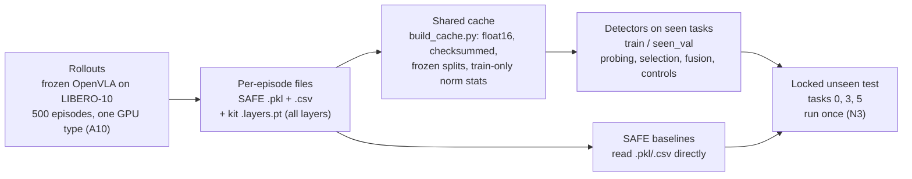

# Project overview: layer fusion for VLA failure detection

Written 2026-11-10 for Akash and for teammates new to the project. Sources: the orchestrator's shared context
(verified 2026-11-10), the collection kit's `collection/README.md` (PR #2, as merged in `upstream/main` `40a9f81`),
`failure_prob/protocol.py`, this repo's `README.md`, and the team task plan v5 (`VLA_Task_Plan_v5`, sheet "Task
Plan", v5 changes dated Nov 10). Plan rows are cited "per plan v5".

For live state (what is running, what is blocked, what has been spent) read [`00_STATUS.md`](00_STATUS.md).
For Akash's own tasks read [`05_MY_WORK.md`](05_MY_WORK.md). Unfamiliar words are in [`06_GLOSSARY.md`](06_GLOSSARY.md).

## 1. The question and the claim

**Research question.** A frozen Vision-Language-Action (VLA) policy carries a robot arm through a task. While it
runs, can we tell from its internal activations that the task is going to fail? More precisely: do *selected
intermediate layers* of the policy, combined through fusion or learned/dynamic weighting, detect failure better than
three controls?

1. the **best single layer** (chosen on seen-task validation),
2. an **all-layer average** (every layer averaged into one vector),
3. a **parameter-matched final-layer detector** (the final layer only, with a detector made as large as ours).

**Narrowed claim** (per plan v5, row P0-5): *selected or adaptive layers beat strong
single-layer and all-layer-average controls.* We do **not** claim to be the first to look at intermediate layers;
see section 4.

## 2. The policy and the benchmark

- **Policy:** `openvla/openvla-7b-finetuned-libero-10`. It is OpenVLA-7B fine-tuned on LIBERO-10. Its language
  backbone is Llama-2-7B: 32 transformer blocks, hidden size 4096, run in bf16. For each control step it emits
  7 action tokens (one per action dimension). **We never train or change it.** Decoding is greedy, with SAFE's
  settings (`flash_attention_2`, `center_crop=True`).
- **Benchmark:** LIBERO-10, a set of 10 long-horizon tabletop tasks in simulation (MuJoCo). Each task has 50 fixed
  initial states, so a full run is **10 x 50 = 500 episodes**. An episode stops on success or at `max_steps=520`.
- **Label:** `failure = 1 - success`, one label per episode.

## 3. SAFE, our baseline

SAFE (Gu et al., NeurIPS 2025, arXiv 2506.09937) is the paper this repository is forked from. It trains a small
detector on the policy's activations to predict failure, and it is built for **unseen tasks**: the detector is
trained on some tasks and tested on tasks it has never seen.

What SAFE uses from the policy:

- the **final layer only**: the last hidden state (`hidden_states[-1]`, which is *after* the final RMSNorm) at each of
  the 7 action tokens, reduced over the tokens by its `token_idx_rel` setting (first, last or mean);
- for some baselines, the action-token probabilities.

SAFE's rollout script (`experiments/robot/libero/run_libero_eval.py` in SAFE's OpenVLA fork, `vla-safe/openvla`)
writes one `.pkl` (features) and one `.csv` (episode summary) per episode. Its detectors are an MLP and an LSTM on
those features, plus a cosine k-NN baseline. Published OpenVLA/LIBERO unseen-task numbers, as listed per plan v5
(rows C1–C3): MLP 73.47, LSTM 72.47, k-NN 69.45, each a mean over 3 splits. We
reproduce these on our own rollouts (Adarsh, C1–C3) rather than copy them.

Our work keeps SAFE's detectors and protocol but asks whether layers *before* the last one help.

## 4. Related work, and why the controls matter

Two recent papers already look inside VLA layers:

- **Hide-and-Seek** (arXiv 2605.30834) averages OpenVLA embeddings across layers and action tokens.
- **VLA-Tug** (arXiv 2611.08425) probes latent layers.

(Plan v5 row P0-5 also lists an "SAE paper" for the related-work update; it is not named in our sources.)

Because of these, "intermediate layers carry failure signal" is not new. The new part has to be that *choosing* and
*fusing* layers adds something beyond simpler alternatives. Each control rules out one cheap explanation:

| If our fusion wins only because... | ...this control catches it | Plan row (v5) |
|---|---|---|
| one good intermediate layer does all the work | best single layer, parameter-matched | K2 (uses R2's best layer) |
| averaging everything is enough (the Hide-and-Seek idea) | all-layer average | S5 |
| our detector simply has more parameters | parameter-matched final-layer wide MLP | K1 |
| averaging the *selected* layers is enough, no learned weights needed | uniform average of selected layers | S6 |
| one layer is duplicated, not complemented | leave-one-layer-out; duplicated-strongest-layer | K3, K4 |

## 5. The pipeline, end to end

Only the first box needs the 7B model and a GPU. Everything after the cache runs on CPU or a small GPU.

1. **Rollouts.** SAFE's own rollout script, patched by the kit (`collection/openvla_all_layers.patch`) with a
   `--save_all_layers` flag. Seed 7, LIBERO's fixed initial states, greedy decoding, so the run is the same for
   everyone. Planned on Modal, one A10 function per task (see [`04_COMPUTE_AND_ENV.md`](04_COMPUTE_AND_ENV.md)).
2. **Per-episode files.** Next to SAFE's unchanged `.pkl`/`.csv`, the kit writes
   `task{t}--ep{e}--succ{0|1}.layers.pt`: a bf16 tensor of shape (steps, poolings, 33 layers, 4096). Layer 0 is the
   embeddings, 1–31 are raw block outputs, 32 is block 32 after the final RMSNorm (equal to SAFE's feature).
   Three poolings over the 7 action tokens: first, last, mean.
3. **Cache.** `collection/build_cache.py` turns the raw files into one versioned cache: one `.npy` per layer, pooling
   and split, plus `episodes.csv` (with `task_min_step`), `splits.json` (explicit episode IDs), train-only
   `norm_stats/`, `provenance/`, `manifest.json` and checksums. `check_cache.py` verifies it; `load_cache.py` reads it
   or exports it to the repo's `FeatureStore` format.
4. **Detectors.** All development uses the seen tasks only: `train` (~60%) and `seen_val` (~40%), stratified by
   outcome. Evaluation is per episode, truncated to each task's shortest episode (`task_min_step`), because failed
   episodes run longer and would otherwise give the label away.
5. **Locked unseen test.** Tasks 0, 3, 5 sit in separate `unseen_test/` folders and are read **once**, at the end
   (row N3). Nobody tunes on them.

Fixed seeds live in `failure_prob/protocol.py`: rollout seed 7; unseen tasks 0, 3, 5 (SAFE's seed-0 task split);
train ratio 0.6; detector training seeds 0, 1, 2. Details of the kit: [`03_COLLECTION_KIT.md`](03_COLLECTION_KIT.md).
Where things live in the repo: [`02_REPO_MAP.md`](02_REPO_MAP.md).

**Kit fixes (in progress).** Before the full run, five must-fixes go into the kit as one follow-up PR: a Modal app,
environment pins, a hard failure if flash-attn is missing, recording crashed episodes as invalid instead of
stopping, and raw (pre-norm) block 32 as one extra layer index (33). They are being implemented now; status is in
`00_STATUS.md`.

## 6. Size and cost (measured vs estimate)

| Number | Value | Kind | Source |
|---|---|---|---|
| Speed in a rollout | 3.29 steps/s; 273 ms per action (median, n=20) | Measured, NVIDIA A40, 2026-11-09, openvla `300dce2` | CARC verification log |
| Peak GPU memory | 14.74 GiB | Measured, same run | same |
| Time per episode | 81–157 s (264 and 520 steps) | Measured, same run | same |
| Full run, A10 | ~12–24 GPU-hours, ~$13–26 | **Estimate** (2026-11-10) | shared context |
| Raw `.layers.pt` | ~0.8 MB/step, ~120–160 GB for 500 episodes; cache about the same again | **Estimate** from A40 measurements | shared context, kit README |

The Modal smoke test (row A5) will replace the A10 estimates with measurements.

## 7. Who owns what

Per plan v5, cross-checked with the shared context of 2026-11-10.

| Person | Owns | Main plan rows |
|---|---|---|
| **Akash** | Compute, collection (kit fixes, smoke test, full run, cache), probing sweep | G0, P0-3, P0-4, R0-PR2, A1, A5, A6, A8, R1–R4 |
| **Rhea** | Collection kit (PR #2), splits, pipeline repair, layer selection | P0-2, P0-5, B1, B4, B5, B8, S1–S6 |
| **Aniruth** | Experiment spec, evaluator, probe spec, gated and residual fusion, locked unseen test, merging PRs | P0-1, B2, B3, B6, B7, F4, F5, N1, N3, M-PR2 |
| **Dhyan** | Loader review, concatenation and static-weight fusion, optional replay inputs | A9, F1–F3, F6, (A2, A3, A7 optional) |
| **Adarsh** | SAFE baselines, cross-check and end-to-end test, controls, aggregation | C1–C5, K1–K4, N2 |

Rule for everyone: do your own rows; report problems in someone else's area to its owner.

## 8. Current phase (2026-11-10)

| Phase | What | State |
|---|---|---|
| 0a | Git cleanup (plan row G0) | Done 2026-11-10 |
| 0 | These understanding docs | In progress |
| 1 | The five kit fixes (CPU only), one follow-up PR | In progress |
| 2 | Modal smoke test (budget ≤ $3) | Not started; needs phase 1 and Akash's approval |
| 3 | Full collection, 500 episodes | Out of scope until Akash approves the cost, the team answers the review checklist, and the fix PR is merged |

Nothing has been spent on Modal so far. The research phase (rows R, S, F, K, N) starts only after the cache exists
and the end-to-end pipeline test (C5) passes.
