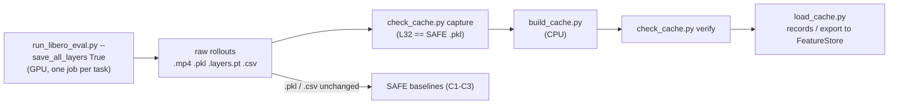

# The collection kit: how Rhea's kit (PR #2) works

Written 2026-11-10. Source: the code as merged at `upstream/main` `40a9f81` (read in the `akash/kit-fixes` checkout,
which has the same `collection/` files plus `constraints.txt`) and the patch's two files on openvla `akash/kit-patch`
`b5cb926`. Line numbers below are from those commits. Plan rows are cited per plan v5 (`VLA_Task_Plan_v5`). Where this
file and the code disagree, the code wins.

In one sentence: **SAFE's own rollout script gets one extra switch, `--save_all_layers`, which writes every hidden
layer next to SAFE's usual files; three CPU scripts then turn those files into one checksummed cache that the whole
team reads.**

The kit's own smoke test has not been run yet (plan v5 row A5: not started, 2026-11-10). The GPU measurements so far
come from Akash's CARC setup (A40, 2026-11-09, openvla `300dce2`) and the T6 test; they are not repeated here.

## 1. The pipeline



## 2. The patch side (openvla, two files)

### 2.1 New flags on SAFE's script

`run_libero_eval.py` takes draccus flags (`--name value`). The patch adds two (lines 82–83):

| Flag | Default | Meaning |
|---|---|---|
| `--save_all_layers` | `False` | Also save all 33 hidden-state layers per step. Requires `--output_hidden_states True` and `n_samples == 1`, else an assertion fails at start-up (lines 125–128). |
| `--all_layers_pooling` | `"mean,first,last"` | Comma list of poolings to store; any other name raises (`layer_cache.py:36-41`). |

SAFE's own flags the kit relies on (unchanged, set by the Slurm scripts): `--output_hidden_states True`,
`--center_crop True`, `--resume True`, `--seed 7`, `--save_logs True`, `--task_start_index`/`--task_end_index`
(inclusive), `--num_trials_per_task 50`, `--save_root`, `--run_id_note`. SAFE's default
`attn_implementation` is `flash_attention_2` (line 78). With `--save_all_layers` off, every patched line is skipped and
SAFE's behaviour is unchanged.

### 2.2 Per-episode outputs

All in `<save_root>/<run_id_note>/libero_10/`, named from the video path (line 428):

| File | Written by | Content |
|---|---|---|
| `task{t}--ep{e}--succ{0\|1}.mp4` | SAFE (line 429) | Rollout video |
| `task{t}--ep{e}--succ{0\|1}.pkl` | SAFE (lines 433–446) | `hidden_states` (T, 7, 4096): final layer at each of the 7 action tokens, plus task/episode/success fields. Unchanged. |
| `task{t}--ep{e}--succ{0\|1}.layers.pt` | Patch (lines 449–460) | All layers, pooled (see 2.3). Written atomically. |
| `task{t}--ep{e}--succ{0\|1}.csv` | SAFE (lines 462–465) | Per-step logs (actions etc.). **Written last; it is the "episode complete" marker.** |
| `provenance/provenance--tasks{start}-{end}--job{SLURM_JOB_ID or "local"}.json` | Patch (lines 170–172) | One per job (see 2.7). |

`t` is the task index 0–9, `e` the episode index 0–49, which is also LIBERO's initial-state index.

### 2.3 The `.layers.pt` payload

A `torch.save` dict (`layer_cache.py:62-73`):

| Key | Value |
|---|---|
| `features` | bfloat16 tensor **(T, P, 33, 4096)**: T env steps, P poolings, 33 layers. (`torch.empty(0)` if the episode had no steps.) |
| `pools` | list of pooling names in the order of axis 1, e.g. `["mean", "first", "last"]` |
| `layer_convention` | the convention string (2.4) |
| `task_suite_name`, `task_id`, `task_description`, `episode_idx`, `episode_success`, `init_state_index` (= `episode_idx`), `seed` | episode metadata (run_libero_eval.py lines 451–459) |

Atomic write: saved to `<name>.layers.pt.tmp`, then `os.replace` (lines 71–73). Only this file is atomic; SAFE's
`.pkl` and `.csv` are written directly (lines 445, 465).

### 2.4 Layer convention, 0–32

From HuggingFace `output_hidden_states` for the Llama-2 backbone (`layer_cache.py:3-8, 29-32`):

- **0** = token embeddings;
- **1–31** = output of decoder block i, before any normalization;
- **32** = output of block 32 **after** the final RMSNorm. This is exactly SAFE's `s[-1]`, so the kit's L32 equals what
  SAFE stores in its `.pkl`.

So spreadsheet "L4" = index 4. Only index 32 is normalized, so raw scales differ across layers. The convention was
confirmed bitwise on a GPU by T6 (`tests/gpu/test_layer_mapping.py`; CARC A40, 2026-11-09, measured).

### 2.5 Poolings

For each of the 7 generated action tokens, take the state at the last sequence position (`[0, -1, :]`) in every
layer, giving (7, 33, 4096); then reduce over the 7 tokens (`layer_cache.py:44-59`):

| Pool | Definition | SAFE equivalent |
|---|---|---|
| `mean` | mean over the 7 tokens, computed in float32 | `token_idx_rel="mean"` |
| `first` | token 0 (the state before the first action token is generated) | `token_idx_rel=0.0` |
| `last` | token 6 | `token_idx_rel=1.0` |

The result is cast to bfloat16 on CPU, so each step adds (P, 33, 4096) bf16 to the episode.

### 2.6 Resume

With `--resume True`, SAFE's own code (lines 179–187) finds `task{t}--ep*--succ*.csv`, takes the **highest** episode
index present, and restarts after it. Two consequences:

- Because the `.csv` is written after the `.pkl` and `.layers.pt`, an episode killed mid-write is simply re-run.
- A missing episode *below* the highest index is never re-run (resume does not fill gaps).

### 2.7 Provenance JSON

`write_provenance` (`layer_cache.py:91-117`) records: the full config, the checkpoint's HF commit hash, the openvla
repo commit, Python version, platform, host name, Slurm job and array IDs, GPU name / compute capability / CUDA /
cuDNN versions, versions of 12 packages (torch, transformers, tokenizers, timm, accelerate, flash-attn, numpy,
tensorflow, robosuite, mujoco, libero, draccus), and the layer convention. It does **not** record the attention
implementation separately from the config, nor the MuJoCo render backend (see E3 below). Note that it records the
host name and job IDs: fine inside the cache, but keep these files out of the public repo.

## 3. The CPU side (Safe-Research `collection/`)

### 3.1 `build_cache.py`: raw rollouts to cache

```bash
python build_cache.py --rollout-dir <run>/libero_10 --cache-root <root> [--version v1]
```

| Behaviour | Where |
|---|---|
| Discovers episodes by `.csv` name; refuses duplicates. Trajectory ID = `libero_10/tNN/eNN`. Label `failure = 1 - success`. | lines 53–73 |
| **Versioned and immutable:** refuses if `<cache-root>/<version>` exists; deletes the partial cache on any error. | 121–123, 327–330 |
| **Completeness:** requires exactly `--expect-tasks` (10) tasks with exactly `--expect-episodes` (50) each, and every `.pkl` and `.layers.pt` present. `--allow-incomplete` (smoke tests only) relaxes the counts, never the missing files. | 113–115, 128–141 |
| Per-episode consistency: steps in `.layers.pt` = rows in `.csv`; success flag matches the file name; same pools/shape in every file; one task name per task; one suite. | 144–165 |
| `task_min_step` = per-task minimum episode length (SAFE's evaluation horizon). | 167 |
| Split: unseen tasks (default 0, 3, 5) go to `unseen_test`; each seen task is split ~60/40 into `train`/`seen_val`, stratified by outcome, seeded by `(split_seed, task)`. `--split-file` reuses an existing `splits.json` instead. | 76–90, 177–186 |
| Features as **float16**, one file per pooling × split × layer: `features/<pool>/<split>/L<NN>.npy`, shape (rows in split, 4096). Refuses non-finite values or any value above float16's max (65504). | 198–236 |
| **Train-only normalization stats:** per pooling, mean and std per layer over all train rows, in float64, saved as `norm_stats/<pool>.npz`. Stored features stay unnormalized. | 238–245 |
| Writes `episodes.csv` (IDs, task, success/failure, length, `task_min_step`, split, row range), `splits.json` (explicit IDs + provenance note), copies `provenance/` and any `--provenance-files`. | 247–275 |
| **Checksums:** SHA-256 of every file (POSIX paths), in `manifest.json` and in `CHECKSUMS.sha256` (`sha256sum -c` format). Manifest also holds the layer convention, pools, dims, split summary, per-task counts and warnings (e.g. a split with one class). | 277–326 |

Caveat on the manifest's dtype note ("converted losslessly in range from bfloat16", line 316): in-range normal values
convert exactly, but values smaller than about 6e-5 in magnitude lose precision in float16.

### 3.2 `check_cache.py`: three checks

| Sub-command | What it checks | Where |
|---|---|---|
| `verify --cache <dir> [--quick]` | Every file against the manifest's size and SHA-256 (`--quick`: size only); `.npy` headers load. Missing `unseen_test/` files count as "withheld", other missing files as "not downloaded"; only corrupted files fail. | lines 39–66 |
| `capture --rollout-dir <dir>` | Per episode: lengths of `.layers.pt`, `.pkl`, `.csv` agree; **`first` at L32 == `.pkl` token 0 and `last` at L32 == `.pkl` token 6, bit for bit**; `mean` at L32 within 1e-2 relative of the `.pkl` mean; no layer identical to the one before it; no NaN/inf. | 118–167 |
| `compare-runs --a <dir> --b <dir> [--layer 32] [--pool mean]` | For episodes in both runs: outcome flips, lengths, first step where actions differ by more than 1e-6, and the largest relative feature difference before that step. A sanity check, not a reproducibility proof. | 78–115 |

Note: `capture` takes "L32" as the **last** index of the layer axis (`f.shape[2] - 1`, line 146), not as index 32.

### 3.3 `load_cache.py`: reading the cache

- `SharedCache(root).records(split, layers, pool, normalize=False, horizon="full")` returns FeatureStore-style records:
  `features` [1, T, K, 4096] float32, `mask`, `labels` = [failure], `task_ids`, `trajectory_ids` (lines 30–79).
  `horizon="task_min_step"` truncates each episode to its task's minimum length. `normalize=True` applies the
  train-only stats.
- **Unseen split is locked:** `records("unseen_test", …)` raises `PermissionError` unless `allow_unseen=True`
  (lines 59–60); the CLI flag is `--allow-unseen`, meant only for the locked final test (plan row N3).
- `python load_cache.py export --cache <dir> --out <dir> --layers 4 24 32 --pool mean [--normalize]` writes one
  `FeatureStore` folder per split (default `train` and `seen_val`) for `scripts/train.py --feature-root`
  (lines 82–114). It needs the repo installed (`pip install -e .`).

### 3.4 `failure_prob/protocol.py` constants

| Constant | Value | Meaning |
|---|---|---|
| `ROLLOUT_SEED` | 7 | SAFE/OpenVLA default; `carc/config.sh` `SEED` |
| `UNSEEN_TASKS` | (0, 3, 5) | What SAFE's `split_rollouts` picks after `seed_everything(0)`, verified by running SAFE's code (`tests/test_shared_cache.py::test_safe_seed0_task_split`) |
| `SEEN_TRAIN_RATIO` | 0.6 | SAFE's OpenVLA train ratio |
| `SPLIT_SEED` | 0 | Used once by `build_cache.py`; afterwards `splits.json` is the source of truth |
| `TRAIN_SEEDS` | (0, 1, 2) | Detector training seeds |

`tests/test_shared_cache.py::test_fixed_seeds_consistent_everywhere` fails if these drift from the scripts. Only the
task-level split matches SAFE; the train/val assignment is the kit's own, so results are "one fixed split", not
SAFE's mean over three splits (`collection/README.md:29-33`).

## 4. The CARC Slurm scripts (`collection/carc/`)

The kit was written for CARC. The current compute plan is **Modal only (A10)** for all GPU work; CARC is shared storage
(per plan v5, rows P0-3, A1). These scripts are kept and fixed so teammates are not misled; they are not the run path.

| File | Role |
|---|---|
| `config.sh` | Edit once: Slurm account, `WORK=/scratch1/<user>/...`, `ROLLOUT_ROOT`, `CACHE_ROOT=/project/CHANGE_ME/...` (CARC's real path is `/project2/<group>`), conda env name, `POOLING`, `SEED=7`, `MUJOCO_GL=egl`. Defines `GPU_TYPE`, but the `.slurm` files hard-code `a40`. |
| `00_setup_env.sh` | Login node, once: conda env (Python 3.10), clones `vla-safe/openvla` and applies the patch (it does not check out `300dce2` explicitly), torch 2.2.0 cu121, LIBERO, the checkpoint. flash-attn install failure only prints a hint to use `sdpa` (line 37). |
| `01_smoke_test.slurm` | Debug partition, 1 h, task 0: RESUME (1 episode, then 2 with resume; episode 0 must not be rerun), CAPTURE, REPEAT + `compare-runs`, BUILD + `verify` of a tiny cache, then `timing_summary.txt`. |
| `02_rollouts.slurm` | Array 0–9, one task per job, 50 episodes, 12 h, `--resume True`. |
| `03_build_cache.slurm` | CPU: `capture` on all episodes, `build_cache.py` with provenance files, `verify`, `chmod g+rX`. |

All three `.slurm` files use `--gpus-per-task=a40:1` (or none, for 03), which failed on CARC; the working form is
`-n 1 --gpus=a40:1` (shared context, 2026-11-10).

Storage, from the kit README (estimate, not measured by the kit): about 0.8 MB per step for 3 poolings × 33 layers,
roughly 150 GB raw for 500 episodes, and about the same again for the cache.

## 5. Changes in progress (follow-up PR) — not yet merged

As of 2026-11-10 none of this is on `main`. It goes in one PR from `akash/kit-fixes` (plan row A1; merge is M-PR2).

**The five must-fixes**

1. **Modal app.** An image with the pins, one A10 function per task, a CPU function that builds the cache; plus the
   CARC syntax fix (`-n 1 --gpus=a40:1`) and a non-conda (uv) fallback.
2. **Environment pins** in every install path, from one file, `collection/constraints.txt` (`numpy<2`,
   `protobuf>=4.25,<5`, `tensorflow-metadata<1.16`, `mujoco<3`).
3. **flash-attn hard-fails if missing.** No silent switch to `sdpa` (today `00_setup_env.sh:35-37` suggests `sdpa`).
4. **Crashes:** record an invalid episode and continue; `build_cache.py` accepts a documented invalid list instead of
   exactly 50 per task (today SAFE's loop re-raises, line 402).
5. **Raw block 32:** add block 32's output before the final norm (forward pre-hook on the norm) as one extra layer.

**Engineering choices the fixes follow**

- **E1.** Raw block 32 becomes index **33**; indices 0–32 keep their meaning. On by default with `--save_all_layers`,
  behind a flag; files carry explicit layer names so 33- and 34-layer files both load.
- **E2.** An invalid episode leaves only `task{t}--ep{e}--invalid.json` (atomic; exception, traceback, step, time).
  Resume treats it as done; systemic errors (Ctrl-C, CUDA out-of-memory) still abort, and so does exceeding a small cap.
  `build_cache.py` requires every missing episode to have a marker and lists them in the manifest.
- **E3.** Attention implementation (must be `flash_attention_2`), GPU type and MuJoCo render backend are recorded per
  job/episode; `build_cache.py` refuses a mixed dataset.
- **E4.** `collection/constraints.txt` is the single source of truth for pins.
- **E5.** Shell file ownership: `00_setup_env.sh`, `config.sh` and a new `activate_env.sh` (conda or uv) belong to
  fix 2; the `.slurm` files and a new portable `collection/smoke_test.sh` belong to fix 1.
