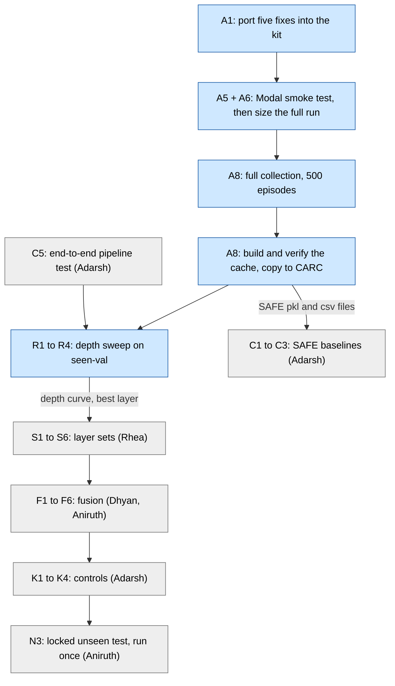

# Akash's work: what is yours, in what order, and who is waiting

Written 2026-11-10. Sources: the team task plan (`VLA_Task_Plan_v5`, sheet "Task Plan"; v4 is outdated) and the orchestrator's
shared context. Every task below carries its plan row ID. For live state, read [`00_STATUS.md`](00_STATUS.md).

In one sentence: **you run the frozen policy once and produce the shared feature cache, then you run the
layer-by-layer probing sweep (R1–R4) on it.** Everything the other four do in the research phase reads your cache,
and Rhea's layer selection reads your sweep.

## 1. The chain

Blue = Akash. Grey = teammates. The sweep cannot start until both the cache (A8) and the pipeline gate (C5) are done.

## 2. Akash's tasks

All rows in the plan whose owner is Akash, in working order. v5 (2026-11-10) already says Modal A10 everywhere.
"Note" marks where this table adds something the plan does not say.

| ID | Task in plain words | Depends on | Status (plan → now) | Done when | Who consumes the output |
|---|---|---|---|---|---|
| R0-PR2 | Line-by-line review of Rhea's collection kit (PR #2). | — | Done | Findings are in the review doc. Verdict: adopt with five must-fixes. | Aniruth and Rhea (review checklist); A1 |
| G0 | Git cleanup: sync the fork's `main` to upstream (`40a9f81`), rebase and squash `akash/extraction`, archive the old collector docs, delete the merged `akash/setup-py`, create `akash/kit-fixes`. | — | Not started → **Done 2026-11-10** | Fork `main` == upstream `main`; clean branches pushed (with `--force-with-lease`). | A1 |
| P0-4 | Confirm GPU access, compute balance and storage location. | — | Done | Access and storage are noted in the plan. | Whole team |
| P0-3 | Set up compute. Modal only for all GPU work, A10 (confirmed by Akash 2026-11-10 as the single GPU type); CARC is shared storage and reference environment, not a backup GPU. $30 hard ceiling. | — | In progress | Modal limits are set and the Modal image builds. (The plan also says "CARC env works as fallback"; that was verified on 2026-11-09.) | A5, A8 |
| A1 | Port the five must-fixes into the kit: Modal app, environment pins, flash-attn hard-fail, invalid-episode handling, raw block 32 as an extra layer index. Also fix the CARC job syntax. A follow-up PR from `akash/kit-fixes` to `main` (PR #2 was merged without the fixes). | P0-1, PR #2 review | Not started → in progress | Kit tests and the new tests pass on Python 3.10; PR is open. | Rhea (review), Aniruth (merge, M-PR2); A5 |
| A4 | Record invalid episodes and make collection resumable. | A1 | Dropped | — (merged into A1) | — |
| A5 | Smoke test on one Modal GPU: headless render, resume, capture, repeat, cache build, plus the T6 layer-hook test, on one Modal A10. | A1, P0-3 | Not started | All kit checks pass; timing summary shared; cost under $3. | A6; Adarsh (C1–C3 may start on "A5 or A8" data); Aniruth (M-PR2) |
| A6 | Size the full run from the smoke timing: GPU-hours, cost, storage plan (delete raw rollouts after the cache is verified, copy the cache to CARC). | A5 | Not started | Cost estimate approved by Akash; storage plan recorded. | A8 (this is the gate for full collection); Adarsh (C5) |
| A8 | Full collection (10 parallel task jobs), then build and verify the cache, then copy it to CARC. On Modal A10. **Note:** the plan's "merged PR #2" dependency should read the merged *fix* PR. | A6, merged fix PR | Not started | Cache verify passes on all 500 episodes (or every gap is a documented invalid episode, per fix 4); the team can read it on CARC. | Everyone: Adarsh (C1–C3), Dhyan (loader check A9), Rhea and Aniruth (pipeline), R1 |
| R1 | Probing sweep over every cached layer, identical settings. | C5, A8 | Not started | Depth curve on seen-val. | R2–R4; Rhea (S5); Adarsh (N2 figures) |
| R2 | Fine sweep around the best layer. | R1 | Not started | Best layer chosen on seen-val. | Rhea (S1–S4); Adarsh (K2) |
| R3 | Pooling check (first / last / mean) at the best layer. | R1 | Not started | Pooling result recorded. | Team decision on the primary pooling (checklist item 4) |
| R4 | Sensitivity: raw vs train-only standardized features. Rhea supports. | R1 | Not started | Both recorded. | Rhea and Aniruth (shared evaluator setting) |

You are also listed as **support** (not owner) on A2, A3, A7 (Dhyan; all optional), B6 (Aniruth's shared probe spec)
and N2 (Adarsh's aggregation and figures).

## 3. The probing sweep, R1–R4

All four read the **cache**, never the raw rollouts and never the 7B model, so they run on CPU or a small GPU. All
four use the `train` and `seen_val` splits only. The unseen tasks (0, 3, 5) stay locked until N3.

**R1 — depth sweep.** Train the same small detector on one layer at a time, for every layer in the cache: indices
0–32, plus index 33 (raw, pre-norm block 32) if the team approves it. It reads one layer per run from
`features/<pool>/{train,seen_val}/`. It produces the **depth curve**: seen-val detection quality against layer
index. This is the input to Rhea's layer selection and to Adarsh's final depth-curve figure (N2). The plan's note is
"one owner, one script": the settings must be identical across layers, and they come from Aniruth's shared probe
spec (B6).

**R2 — fine sweep around the best layer.** The plan's "done when" is clear: one best layer, chosen on seen-val.
Rhea's S1–S4 and Adarsh's K2 control all wait on it. The *method* is not clearly defined: the plan's note says
"needs replay or stored neighbours", which predates the kit. The kit stores all layers, so R1 already covers every
neighbour. What extra R2 adds (more seeds? a tie-break rule?) is an open question for the team.

**R3 — pooling check.** At the best layer, compare the three ways the kit pools the 7 action-token states: first,
last, mean. It reads the same layer from the three `features/<pool>/` folders and produces one recorded comparison.
It feeds the team's one-time choice of primary pooling. It only works if all three poolings are kept in the cache
(checklist item 7).

**R4 — normalization sensitivity.** Run the probe on raw features and on features standardized with train-only
statistics (the cache's `norm_stats/`). Both results are recorded. The plan does not say which decision this
settles; the kit's README calls normalization "a shared evaluator choice, applied identically to every model", so
the natural reader is whoever fixes that setting (Rhea owns standardization, B5).

**What exists today for probing:** `scripts/probe_layers.py` is synthetic-only. It raises an error unless
`--synthetic` is passed, trains for one epoch on generated data with 8-dimensional features, and prints a training
loss. It does not read the cache, does not score seen-val, and produces no curve. Making it run on real data is
row B3, owned by Aniruth.

## 4. Hand-offs

**What you need from others**

| From | What | Needed before |
|---|---|---|
| Team (via Aniruth) | Answers to checklist items 3 (raw block 32), 4 (primary pooling, all-layer-average definition), 5 (one split or three), 7 (storage plan). These change what gets stored. | Full collection (A8) |
| Team (via Aniruth) | Approvals: items 2 (kit is the single collection path), 6 (Modal only, A10), 11 (merge the fix PR) | Full collection (A8) |
| Rhea | Review of the fix PR (it changes her kit) | Merge |
| Aniruth | Merge of the fix PR (you have read-only access upstream) | A8 |
| Aniruth | Shared probe spec (B6) and real-data probing and evaluation scripts (B3) | R1 |
| Rhea, Aniruth, Adarsh | Pipeline repair B1–B4 and the end-to-end test C5 | R1 |

**What you give to others**

| To | What | From task |
|---|---|---|
| Everyone | Cache location on CARC, `manifest.json`, checksums, and the list of invalid episodes if any | A8 |
| Everyone | Timing summary and measured cost from the smoke test | A5, A6 |
| Adarsh | SAFE's own `.pkl` / `.csv` rollout files for the baselines (no converter needed) | A5 or A8 |
| Dhyan | A real cache to test the loader export against | A5 or A8 |
| Rhea | Depth curve (R1) and best layer (R2), for layer sets S1–S6 | R1, R2 |
| Adarsh | Depth-curve numbers for figures (N2); best layer for control K2 | R1, R2 |
| Team | Pooling result and raw-vs-standardized result | R3, R4 |

## 5. Not Akash's

Do not do these, even if they look close to your work. Report problems to the owner instead.

- **Splits, the split manifest, pipeline repair (B1, B4, B5, B8), layer selection (S1–S6):** Rhea.
- **The experiment spec (P0-1), evaluator, `best.pt` selection, probe spec, missing models (B2, B3, B6, B7), gated
  and residual fusion (F4, F5), the locked unseen test (N3), merging PRs:** Aniruth.
- **The loader review (A9), concatenation and static-weight fusion (F1–F3, F6), optional replay inputs (A2, A3, A7):** Dhyan.
- **SAFE baselines (C1–C3), cross-check and end-to-end test (C4, C5), controls (K1–K4), aggregation (N2):** Adarsh.
- **SAFE's original files** under `failure_prob/model`, `failure_prob/data`, `failure_prob/conf`, `failure_prob/utils`: nobody edits these.
- **Unseen-task data (tasks 0, 3, 5):** nobody reads, scores or tunes on it before N3.

## 6. Right now (2026-11-10)

1. **Kit fixes (A1), CPU only** — in progress. Five fixes become one follow-up PR from `akash/kit-fixes`.
2. **Modal smoke test (A5)** — not started. Needs the fixes done and your approval. Budget: under $3.
3. **Full collection (A8)** — out of scope until three things are true: you approve the cost (A6), the team answers
   the checklist, and the fix PR is merged.

Nothing has been spent on Modal so far. Live state, blockers and budget are in [`00_STATUS.md`](00_STATUS.md).
